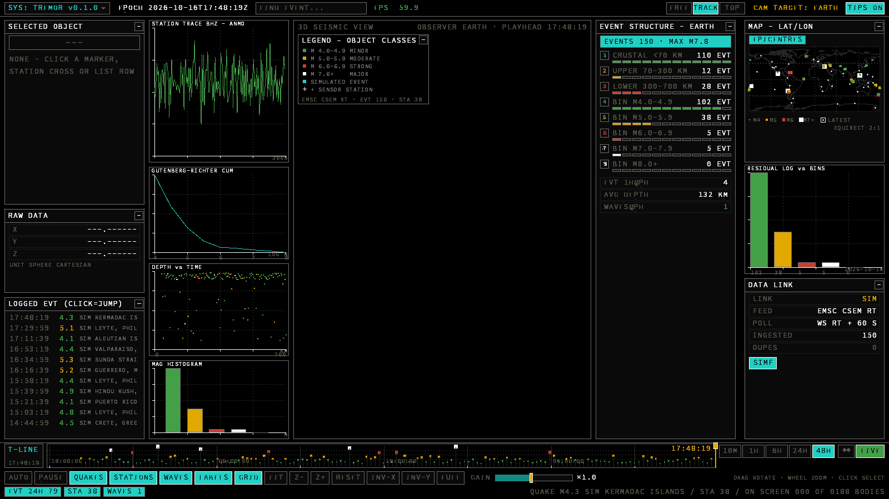

# TREMOR — Real-Time 3D Seismic Monitor

Native Windows desktop dashboard rendered with **Rust + wgpu** (Direct3D 12 /
Vulkan), styled after the **ORRERY HMI design language**
(github.com/bitseq27/orrery, `crates/app/src/{theme,widgets,layout}.rs`):
flat, hard-edged monochrome cells on pure black — `#0A0A0A` cell fills with
1 px `#6E6E6E` rules and white highlights — plus the three orrery accents
(cyan `#21D0C5`, amber `#E0A800`, alarm `#D23B2E`) and phosphor green
`#43A047`. No gradients, no rounding, no shadows. Type is the **VT323**
pixel face (OFL, bundled in `assets/fonts/`) rendered at the orrery UI sizes:
16 px banners/body, 13 px labels/readouts/keys, 10 px plot annotations.

Live seismicity is pulled from the USGS feed every 60 s on an isolated tokio
worker thread; events ≥ M4.0 become glowing epicentre billboards and GPU-side
expanding wave fronts on a textured 3D globe.


*HUD composed by `examples/hud_preview.rs` (software rasteriser, no GPU
needed) — regenerate with `cargo run --example hud_preview`.*

## Globe lighting, sky & playback transport
- Day/night terminator follows the reviewed instant (playhead); the night
  side shows baked city lights (GeoNames cities15000, CC-BY 4.0).
- Procedural starfield + phase-shaded moon behind the globe.
- Capital cities ring-marked and name-labelled (CITIES toggle).
- PLAY/STOP transport with a small log speed slider (1x..240x); wave fronts
  replay from event origin times while scrubbing; fresh events flash a fast
  ring over the globe; LOGGED EVT panel scrolls with the wheel.

## Interface (orrery HMI vocabulary)

* every panel is a **cell**: black `#0A0A0A` fill, 1 px `#6E6E6E` border,
  uppercase white title strip with a separator line at 24 px, and a 16×16
  `[–]` collapse chip; collapsed panels become thin `#1A1A1A` strips with a
  centred `[+ LABEL]` chip (orrery `draw_strip`);
* **readout rows**: hairline `#1C1C1C` borders, grey `#57574A` label left,
  colour-coded value right (orrery `readout`);
* **HMI keys**: idle = cell fill + grey text + grid border, hover =
  `#161616` + white, active = solid accent + black ink + white border
  (orrery `hmi_key`; AUTO carries the amber accent, PAUSE the alarm accent);
* **tab strips** (camera modes FREE/TRACK/TOP, timeline spans 10M…ALL):
  active tab solid cyan with black ink (orrery `tab_strip`);
* **scope plots**: black field, dotted `#2E2E2E` grid, white axes with 4 px
  ticks, title inside top-left (orrery `scope_frame` / `spec_graph`);
* **segment bars** for depth-zone / magnitude-bin gauges (orrery
  `segment_bar`), **status cells** with black ink for counters and the
  LIVE/REVIEW states (orrery `status_cell`);
* **MAP - LAT/LON** letterboxes the equirectangular projection at its true
  2:1 aspect (no stretched continents) with a magnitude/reticle key;
* timeline span tabs **10M / 1H / 6H / 24H / 48H** over the rolling 48 h
  event memory (default 48H);
* **FIND EVENT** field in the header (orrery FIND BODY): click to focus,
  type to populate a dropdown as you type, click a row or press ENTER to
  select that event, ESC closes;
* **TIPS ON/OFF** header key gates the plain-language hint strings;
* header carries SYS combo + ▼, EPOCH readout, REVIEW chip, FPS readout
  (green > 50, amber > 25, alarm below), camera tabs, CAM TARGET in amber;
* bottom console: T-LINE scope with draggable amber playhead knob, span
  tabs, rewind, LIVE key; key row with a log-mapped draggable GAIN slider
  (amber knob, white border); status-cell counters row.

Palette tokens live in `src/palette.rs` as sRGB-decoded (linear) floats so
the sRGB swapchain displays exactly the orrery `Color32` bytes; the globe
texture is baked flat in the same tokens (near-black ocean, `#1A1A1A` land,
`#6E6E6E` coastlines, ALARM/AMBER/CYAN plate boundaries) and the shaders use
the same accents for wave fronts, graticule and rim light.

## Running on Windows

`ship/tremor-windows-x86_64.zip` contains a self-contained
`tremor.exe` (x86_64, GNU ABI, no sidecar DLLs — imports verified to be
Windows-system DLLs only). Requirements: Windows 10/11 with any
D3D12- or Vulkan-capable GPU (the app prefers DX12, falls back to Vulkan).

```
tremor.exe                 # live USGS feed
tremor.exe --sim           # offline demonstration feed (no network needed)
tremor.exe --frames 240 --shot out.ppm   # headless snapshot mode (CI / validation)
```

Rendering is capped at 60 fps (`ControlFlow::WaitUntil` pacing + present
gate), so fast GPUs stay silent and the HUD FPS readout settles at ~60.

### Controls

| input            | action                                    |
|------------------|-------------------------------------------|
| left drag        | rotate globe (inertial; idle globe holds still) |
| mouse wheel      | zoom (clamped 1.45-9.0 radii)             |
| click / pen tap  | select event or station, or hit HUD keys (stylus & touch supported) |
| touch drag / pinch | rotate / zoom on tablets & pen displays |
| FIND EVENT field | type-as-you-search event list; ENTER picks best match, ESC closes |
| `[-]`/`[+]` chip | collapse / expand any panel (orrery style) |
| GAIN slider      | drag for trace gain 0.3×-4.0× (log)       |
| timeline         | drag the playhead; span tabs 10M…ALL; LIVE returns to now |
| `G` / `W` / `L`  | toggle graticule / wave fronts / labels   |
| `S` / `F`        | toggle auto-spin / local simulator (SIMF key also clickable) |
| `Space` / `P`    | pause feed ingestion                      |
| `Esc`            | close FIND list, else quit                |

## Building

### Native Windows (recommended for development)

Install the Rust toolchain (MSVC or GNU), then double-click **`launch.bat`**
(builds the release exe if stale and runs it; `launch.bat --sim` for the
offline demo feed, `launch.bat rebuild` to force a rebuild) or simply:

```
cargo run --release
```

### Cross-compile from Linux (how the shipped exe was produced)

```
rustup target add x86_64-pc-windows-gnu
sudo apt install mingw-w64            # provides x86_64-w64-mingw32-gcc
cargo build --release --target x86_64-pc-windows-gnu
```

### Assets & fonts

`tools/gen_fonts.py` rasterises the three Source Code Pro bitmap faces
(10/13/16 px, common baseline, 8-bit anti-aliased coverage cells) from
`assets/fonts/SourceCodePro-Regular.ttf` (SIL Open Font License, see
`assets/fonts/OFL-SourceCodePro.txt`); `tools/gen_assets.py` rebuilds the land
mask and plate-boundary segments. `examples/emsc_probe.rs` is a tiny protocol
probe for the EMSC socket (`cargo run --example emsc_probe`).
`examples/hud_preview.rs` software-renders the composed HUD to
`shots/hud_preview.ppm` for GPU-less visual checks.

## Changelog highlights

* **2026-10-17** — live source switched to the **EMSC-CSEM realtime feed**
  (same socket as emsc-csem.org; 48 h back-fill + sub-minute pushes, USGS
  kept as automatic fallback); globe shows the rolling **48 h** window with
  magnitude-sized/coloured dots and a **crosshair+circle reticle** on the
  newest event; **Source Code Pro** replaces VT323 (legible small sizes,
  anti-aliased atlas); **MAP panel** now letterboxed at true 2:1 aspect.
* **2026-10-16** — interface restyled to the orrery HMI design language
  (cells, title strips, readouts, keys, tabs, scope frames, VT323 at
  16/13/10 px); pointer fix: orbit now engages only while a button is held
  (hover no longer spins the globe, so click-selection works); duplicate
  station-marker draw removed.
